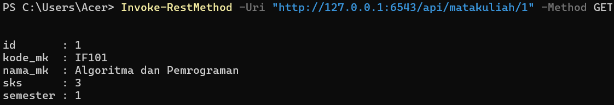
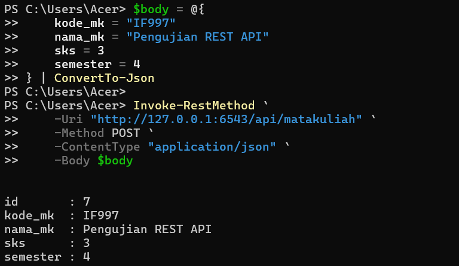
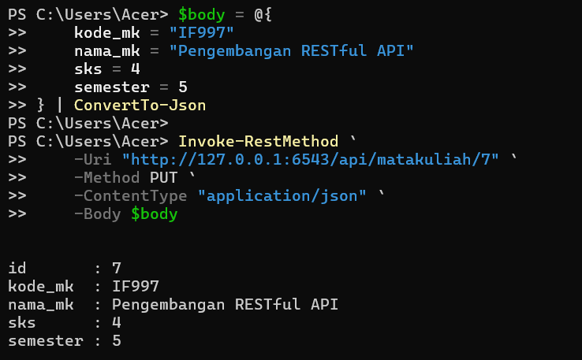
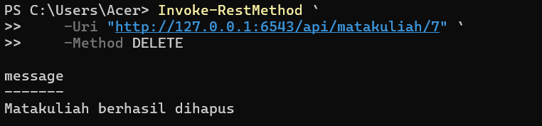
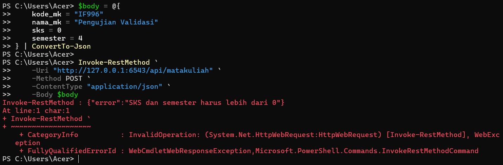
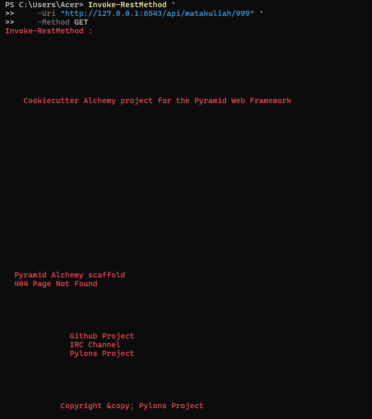
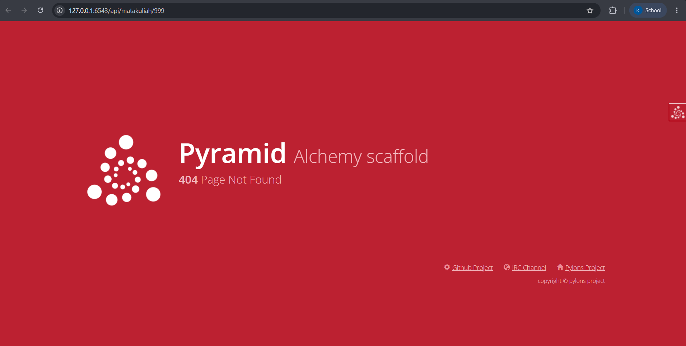

# Aplikasi RESTful API Manajemen Matakuliah

## Identitas

- **Nama:** Angken Muhatun Nufus
- **NIM:** 124140065

## Deskripsi

Project ini merupakan aplikasi RESTful API untuk mengelola data mata kuliah. API dibuat menggunakan Pyramid Framework dan PostgreSQL sebagai database.

Aplikasi ini memiliki fitur CRUD (Create, Read, Update, Delete) untuk menambah, melihat, mengubah, dan menghapus data mata kuliah.

## Teknologi yang Digunakan

- Python
- Pyramid Framework
- PostgreSQL
- SQLAlchemy ORM
- Alembic
- Waitress

## Struktur Data Matakuliah

Data matakuliah memiliki beberapa atribut:

| Atribut | Keterangan |
|---|---|
| id | ID matakuliah |
| kode_mk | Kode mata kuliah |
| nama_mk | Nama mata kuliah |
| sks | Jumlah SKS |
| semester | Semester mata kuliah |

## Fitur API

| Method | Endpoint | Fungsi |
|---|---|---|
| GET | `/api/matakuliah` | Menampilkan semua matakuliah |
| GET | `/api/matakuliah/{id}` | Menampilkan matakuliah berdasarkan ID |
| POST | `/api/matakuliah` | Menambahkan matakuliah |
| PUT | `/api/matakuliah/{id}` | Mengubah data matakuliah |
| DELETE | `/api/matakuliah/{id}` | Menghapus matakuliah |

## Validasi

API memiliki beberapa validasi, yaitu:

- Semua atribut wajib diisi saat menambahkan atau mengubah data.
- SKS dan semester harus berupa angka positif.
- Kode matakuliah tidak boleh sama.
- Mengembalikan status 404 jika data tidak ditemukan.
- Mengembalikan status 400 jika data yang dikirim tidak valid.

## Cara Menjalankan Project

### 1. Mengaktifkan Virtual Environment

```powershell
.\venv\Scripts\activate
```

### 2. Menginstal Dependensi

```powershell
pip install -e ".[testing]"
```

### 3. Menjalankan Migrasi Database

```powershell
alembic -c development.ini upgrade head
```

### 4. Mengisi Data Awal

```powershell
python -m pyramid_mahasiswa.scripts.initialize_db development.ini
```

### 5. Menjalankan Server

```powershell
pserve development.ini --reload
```

Server berjalan pada:

`http://127.0.0.1:6543`

## Dokumentasi Pengujian


## Dokumentasi Pengujian

### 1. GET Semua Data Matakuliah
Menampilkan seluruh data matakuliah yang tersimpan di database.



### 2. GET Matakuliah Berdasarkan ID
Menampilkan data matakuliah berdasarkan ID tertentu.



### 3. POST Menambahkan Matakuliah
Menambahkan data matakuliah baru ke dalam database.



### 4. PUT Mengubah Data Matakuliah
Memperbarui informasi matakuliah berdasarkan ID.



### 5. DELETE Menghapus Matakuliah
Menghapus data matakuliah berdasarkan ID.



### 6. Validasi Input
Memastikan API menolak data dengan nilai SKS yang tidak valid.



### 7. Respons 404 Not Found
Menampilkan respons ketika data matakuliah tidak ditemukan.



